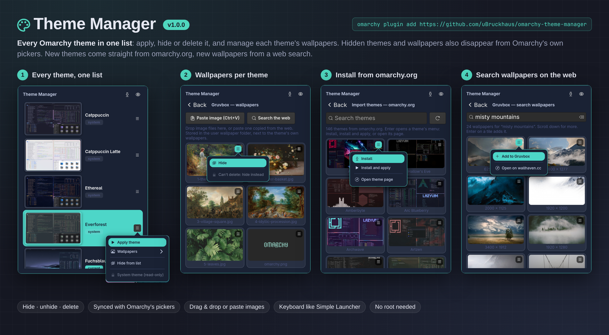

# Theme Manager

Every Omarchy theme, user and system, in one popup: apply, favorite, hide or delete it, and manage the wallpapers that come with it or that you add. Make your own themes from any theme or any picture, give every workspace its own wallpaper, and every theme its own key.



## Features

- **All themes in one place.** User themes (`~/.config/omarchy/themes/`) and system themes (`/usr/share/omarchy/themes/`) in a single scrollable list, each with a large preview and badges for current/system/hidden themes.
- **Apply a theme** from its ⋮ menu.
- **Hide themes** from the list via the ⋮ menu. Hidden themes stay installed; the eye button in the header shows them again (dimmed) so you can unhide them. Hidden state is stored in `~/.config/omarchy/theme-manager/hidden.json`. Applying a hidden theme, from Theme Manager or with `omarchy theme set`, unhides it automatically. The theme you are using always stays in Omarchy's picker, even while hidden; otherwise a picker with every theme hidden would be empty, and Omarchy's picker shows its last full list instead of an empty one.
- **Optionally hidden in Omarchy's pickers, too.** Off by default. Switch on **Settings (⚙) → Also hide in Omarchy's pickers** and hidden themes also leave Omarchy's own theme switcher (Menu → Style → Theme), hidden wallpapers its background picker. Unhiding brings them back. See *Syncing with Omarchy's pickers* below.
- **Make your own themes.** **New theme from this…** in any theme's ⋮ menu opens an editor: give it a name, pick the colors (background, text, accent, selection, muted text, the eight terminal colors, and under *More colors* every shade and bright variant) with a color picker or as `#rrggbb`, and choose a font. A sample window shows the result as you go. The base theme's wallpapers are copied over (you can switch that off) and can be changed later on the new theme's wallpaper page like in any of your themes. **Edit theme…** changes a theme made this way again: its name (renaming keeps its wallpapers, favorites, workspace wallpapers and day/night choices), colors and font; saving the theme you are using applies it right away. Omarchy builds every app's colors (terminals, editors, the bar, Hyprland borders, …) from the colors you pick.
- **A theme from a wallpaper.** **New theme from this wallpaper…** in a wallpaper's ☰ menu takes the colors from the picture: the background in its main hue (dark, or light for bright pictures), the accent from its most vivid color, and every terminal color from the picture's own shade of that hue where it has one, at one lightness so all stay readable. The editor opens with those colors and the name of the picture, ready to adjust; the new theme gets that wallpaper (and, if you like, the base theme's others).
- **A font per theme.** Omarchy has one monospace font for the whole system (Menu → Style → Font). A theme you made can remember one: applying the theme switches to it, and applying any other theme switches back to the font you had before.
- **Favorites and recently used.** ★ a theme in its ⋮ menu and it is listed first, and offered when you right-click the bar icon. Settings (⚙) can also sort the rest by when you last used them.
- **Delete user themes** after an explicit confirmation. They go to the trash (the same one your file manager uses), and **Undo** (or Ctrl+Z) in the popup brings them back for a few seconds afterwards. Wallpapers you added to the theme are kept. The active theme cannot be deleted: apply another theme first. Only themes in your own themes directory can be deleted; system themes are root-owned and read-only here — hide them instead.
- **Wallpapers per theme.** Open a theme's wallpaper page to see what it ships. Add your own by **drag & drop** of image files from the file manager or of pictures straight from a web page, or by **pasting** (Ctrl+V) an image copied in the browser or a file copied in the file manager. iPhone photos (HEIC) are converted to JPEG. Each wallpaper's ☰ menu can set it as the background (current theme), **hide** it, or **delete** it. Added wallpapers are stored in `~/.config/omarchy/backgrounds/<theme>/`.
- **Add wallpapers with a file chooser.** The first tile on a wallpaper page, **Add wallpapers…**, opens a file chooser in `~/Pictures` (the popup steps aside while it is open). It is also where pictures go: drop them anywhere on the page (the tile lights up) or paste them with Ctrl+V.
- **Preview before you decide.** Hold **Space** on a wallpaper (or on a web search result) and it shows on the desktop until you let go; **Preview on desktop** in its ☰ menu shows it for five seconds. Your background is not changed.
- **A wallpaper for each workspace.** In a wallpaper's ☰ menu, **Show on workspace…** picks workspaces 1–10. Whenever you switch to one, its wallpaper fades in; other workspaces keep the theme's background. Assignments belong to a theme, so every theme can have its own set. Tiles show their workspaces (`ws 2 · 5`).
- **Wallpaper slideshow.** Settings (⚙) → **Change the wallpaper** every 5 minutes to 2 hours, through the current theme's visible wallpapers. Workspaces with their own wallpaper keep it.
- **Day and night themes.** Pick a day and a night theme (in Settings, or **Use as day/night theme** in a theme's menu) and the times they start. Theme Manager switches at those times; a theme you pick by hand in between stays until the next switch.
- **From the bar.** Scroll on the paint-brush icon for the next or previous wallpaper; right-click it for your favorite themes (or the recently used ones), the next wallpaper, and Theme Manager itself.
- **Resizable and movable.** Drag the grip in the bottom-right corner to resize, the title bar to move. At the default width themes are a list; wider, they become tiles in columns, like the wallpaper, web search and import pages. **Double-click the title bar**: at the default size either mouse button maximizes, maximized either one goes back to the default size; in between, left goes back to the default size and right maximizes (both centred). A small hint in the header says what a double-click does right now. Double-clicking the grip also restores the default size. Size and position are remembered.
- **Hidden wallpapers** (with the Omarchy sync on) leave Omarchy's background picker, *next background* and the background chosen on theme switch. The files stay where they are, so hiding works for every wallpaper. If the hidden one is on the desktop, the next visible one takes its place. The last visible wallpaper of a theme cannot be hidden.
- **Search wallpapers on the web.** On a theme's wallpaper page, **Search the web** (Ctrl+F) searches [wallhaven.cc](https://wallhaven.cc) for whatever you type: safe-for-work landscape images of at least 1920×1080, with more results as you scroll. A result's ☰ menu adds it to the theme, adds it and sets it as the background (current theme), or opens its page in your default browser.
- **Import themes from [omarchy.org](https://omarchy.org/themes/)** (download button in the header, or Ctrl+I): the whole gallery with previews and search. A theme's ☰ menu installs it, installs and applies it, or opens its GitHub page in your default browser (a hint appears if none is set).

## Deleting versus hiding wallpapers

| Wallpaper | Delete (to the trash) | Hide |
| --- | --- | --- |
| Added by you (`~/.config/omarchy/backgrounds/<theme>/`) | yes | yes (moved to `.hidden/` inside that folder) |
| In a theme you created yourself | yes | yes |
| In a theme installed from git | no: `omarchy theme update` runs `git pull`, which a deleted file would break | yes |
| In a system theme (`/usr/share/omarchy/themes/`, owned by root) | no: needs root, and the next Omarchy update restores it | yes |

Theme Manager never asks for root. Shipped wallpapers are hidden by name in `~/.config/omarchy/theme-manager/hidden-wallpapers.json` and removed only from Omarchy's per-user copy of the current theme (`~/.local/state/omarchy/current/theme/backgrounds/`), which `omarchy theme set` rebuilds on every switch. With the Omarchy sync on, a theme-set hook (`~/.config/omarchy/hooks/theme-set.d/90-theme-manager`) re-applies the hidden list after each switch.

## Languages and settings

The interface is built in in eight languages: English, German (Deutsch), French (Français), Spanish (Español), Italian (Italiano), Portuguese (Português), Dutch (Nederlands) and Polish (Polski). It follows the system language (`LC_ALL`, `LC_MESSAGES`, `LANG`) and falls back to English. To pick another one, open the **gear (⚙)** at the top right of the panel → **Language**. The translations ship with the plugin: nothing is downloaded or generated, and the plugin makes no extra requests for them. The choice is stored in `~/.config/omarchy/theme-manager/settings.json` (`"language"`); the bar icon's tooltip and right-click menu follow it too; **System (…)** removes it again.

The settings page opens from the gear and closes with **← Back**, Backspace or Esc. Switching the language restarts the popup on the settings page, so every label is rebuilt.

The **ⓘ** button beside the gear opens an **Information** page with a card for each of the author's other plugins in the Omarchy Plugin Marketplace, with a short description in the panel's language. A click on a card opens that plugin's marketplace page in the browser (a fixed `https://plugins.omarchy.org/plugin.html?id=…` address); nothing is downloaded. **← Back**, Backspace or Esc returns.

## Install

```sh
omarchy plugin add https://github.com/uBruckhaus/omarchy-theme-manager.git --enable
```

A paint-brush button appears in the bar. Click it to open or close the popup. The popup stays running in the background between opens so it appears instantly; it holds no data of its own.

The popup is a floating card that stays open while you work in other windows, so you can drag pictures into it: only the bar icon or **Esc** closes it. Drag its title bar to move it (the position is remembered), double-click the title to bring it back to its default size, centered; drag the grip in the bottom-right corner to resize it. The keyboard follows the mouse, as everywhere in Omarchy.

### Keyboard shortcuts

Set keys in **Settings (⚙) → Keyboard shortcuts**: **Open Theme Manager**, **Next wallpaper**, **Previous wallpaper** and **Next favorite theme** (cycles through your ★ themes). Every theme can have its own key too: its ⋮ menu → **Shortcut…**; the key then applies that theme from anywhere, and the theme shows it in the list. A theme's key also works while the theme is hidden (applying it unhides it, as always). When you delete the theme, its key is removed once Undo is no longer offered, and the key, or the binding it had taken over, works as before. A key whose theme was deleted outside Theme Manager says so when pressed and is removed then.

The shortcut page works like Launch & Bind's: hold the modifiers and press a key, or toggle Super/Shift/Ctrl/Alt and click a key. Every letter, digit and the other keys are coloured by who has them: green free, yellow one of your bindings (or another Theme Manager key), orange an Omarchy default. A taken key can be **Rebind**-ed: the original binding is turned off only while your shortcut exists, and **Remove** gives it back. While the page is open, Hyprland is switched to an empty submap so even bound combos reach the page (Super + Escape leaves it should anything go wrong).

Keys are kept in `~/.config/omarchy/theme-manager/shortcuts.json` and written to `~/.config/hypr/theme-manager-shortcuts.lua`, which a marked line at the end of `~/.config/hypr/hyprland.lua` requires (a backup is kept as `hyprland.lua.before-theme-manager-shortcuts`). Your own files are never edited otherwise. Every change is checked with `hyprctl configerrors` and rolled back if Hyprland rejects it. Removing the last shortcut deletes the generated file and the marked line again.

## Use

1. Click **Theme Manager** in the bar. The list shows every installed theme; your current theme is marked.
2. **Click a theme row** to open its wallpaper page.
3. **⋮ menu** on a row applies the theme, opens its wallpapers, adds it to your favorites, makes it the day or night theme, hides or unhides it, or deletes it (user themes only, with confirmation). The popup stays open afterwards, so you can apply or delete several themes in a row; applying also restyles the popup in the new theme's colors.
4. **Eye button** in the header shows or hides the themes you have hidden.
5. On the **wallpaper page**, drag image files from the file manager or pictures from a web page (tested with Chrome, Chromium and Vivaldi) onto the popup, or paste with Ctrl+V an image copied in the browser ("Copy image") or a file copied in the file manager, to add wallpapers to that theme. HEIC photos are converted to JPEG (needs libheif's `heif-dec`). ✕ removes a wallpaper you added.
6. **Keyboard**, as in Simple Launcher: ↑/↓, Page Up/Down, Home/End select a theme; **Enter** opens its wallpapers; **→** (or the Menu key) opens its action menu, **←** or **Backspace** closes it. On the wallpaper and import pages the arrows move between tiles, **Enter** opens a tile's menu (on **Add wallpapers…**: the file chooser), holding **Space** previews a wallpaper on the desktop, and **←** (from the left column), **Backspace** or **Esc** go back. **Ctrl+Z** undoes a delete while Undo is offered. On the import page, typing searches. **Type to filter**, as in Simple Launcher: typing on the theme list or a wallpaper page filters it by name (the title shows the filter, Backspace removes a character, Esc clears it). **Ctrl+I** opens the import page, **Ctrl+F** on a wallpaper page opens the web search (Enter searches, ↓ moves into the results); Esc on the list closes the popup.

## Settings (⚙)

| Setting | What it does | Default |
| --- | --- | --- |
| Language | Interface language: the system's, or one of the eight built-in ones | System |
| Corners | The popup's and theme cards' corners: **Like windows** follows Hyprland's window rounding (set by the current theme's `hyprland.lua` or your `~/.config/hypr/looknfeel.lua`; the tooltip says which), **Rounded** (12 px) or **Square** | Like windows |
| Sort the list | By name, or recently used first (favorites always come first) | By name |
| Also hide in Omarchy's pickers | See *Syncing with Omarchy's pickers* below | Off |
| Switch themes by time of day | Day theme from one time, night theme from another | Off |
| A wallpaper for each workspace | Shows the wallpapers picked with **Show on workspace…** (switched on by the first pick) | Off |
| Change the wallpaper | Slideshow through the current theme's visible wallpapers | Never |

**Reset to defaults** (bottom left of the settings page) sets: system language, corners like the windows, sorted by name, Omarchy sync on, no day/night switching (07:00 / 19:00), a wallpaper for each workspace on, the wallpaper never changes. Shortcuts, favorites, hidden themes and the chosen day and night themes stay.

Up to 1.5 the popup always had 12 px corners (it misread Hyprland's rounding); pick **Rounded** to keep that look.

Workspace wallpapers, the slideshow and day/night switching are run by the bar widget, which is part of the Omarchy shell anyway: it calls `theme_auto.py` when you switch workspaces (only while workspace wallpapers are on) and once a minute (only while the slideshow or day/night switching is on). Nothing runs when they are off. Backgrounds are set with Omarchy's own `omarchy-theme-bg-set` and themes with `omarchy theme set`, so Omarchy's pickers stay in step.

## Syncing with Omarchy's pickers (opt-in)

Off until you switch it on in **Settings (⚙)**. Without it, hiding applies to Theme Manager's own lists only and Theme Manager writes nothing into Omarchy's files. When you switch it on:

Omarchy's theme picker shows one preview per theme from its cache in `~/.cache/omarchy/theme-selector/previews/`. Theme Manager keeps hidden themes out of it:

- Hiding a theme removes its preview link from that cache (only the link; no theme file is touched). Unhiding asks Omarchy to rebuild the cache.
- Theme Manager points the menu's **Theme** entry at its `theme-switcher` wrapper by adding one marked line to `~/.config/omarchy/extensions/omarchy-menu.jsonc`. The wrapper runs Omarchy's unchanged `omarchy-theme-switcher` and drops hidden themes again whenever Omarchy rebuilds its cache. If you already override `style.theme` yourself, your entry is left alone.

Deleting or installing a theme changes the theme folders, which makes Omarchy rebuild that cache. Theme Manager rebuilds it right away through the wrapper, and the theme-set hook does the same after `omarchy theme install`, so Omarchy's own rebuild finds nothing to do and hidden themes stay hidden.

- It installs the hook `~/.config/omarchy/hooks/theme-set.d/90-theme-manager`, which re-applies hidden wallpapers and the theme filter after every `omarchy theme set`.

**Switching it off** removes exactly the marked menu line and the hook again, and lets Omarchy rebuild its pickers with everything. `omarchy plugin remove` does not run plugin code, so switch the sync off *before* removing the plugin (or delete the two lines below `// theme-manager:` in that file and the hook by hand).

## Remove

```sh
omarchy plugin remove ubruckhaus.theme-manager
```

This removes the bar button and the popup. Your themes and the wallpapers you added are **not** touched. If you had switched on the Omarchy sync, switch it off first (Settings ⚙), or afterwards remove the marked lines in `~/.config/omarchy/extensions/omarchy-menu.jsonc` and `~/.config/omarchy/hooks/theme-set.d/90-theme-manager`. To also drop Theme Manager's own state and caches:

```sh
rm -rf ~/.config/omarchy/theme-manager ~/.cache/theme-manager
```

## Privacy and capabilities

- Never asks for root or administrator rights; no bundled binaries.
- Network access only for **Import themes**, which contacts only `https://omarchy.org` (the gallery page and its preview images), and **Search the web**, which contacts only Wallhaven: the search API on `wallhaven.cc`, thumbnails on `th.wallhaven.cc` and images on `w.wallhaven.cc`. Every address in an API reply must match its exact expected shape, the safe-for-work filter is fixed, and your search text is only a URL-encoded query parameter. Both go through `curl` with HTTPS only, no redirects, and a size and time limit on every request. The theme list is cached for a day in `~/.cache/theme-manager/`, and at most 400 wallpaper thumbnails in `~/.cache/theme-manager/wallhaven/`. Installing runs `git clone --depth 1` of the theme's `https://github.com/<owner>/<repo>` link after Omarchy's own `omarchy-git-url-check`, without prompts, into `~/.config/omarchy/themes/<name>`. An existing theme is never replaced. Theme pages open with `omarchy-launch-browser`.
- Runs `omarchy theme …`, `omarchy-theme-bg-set`, `omarchy-shell -q background set`, `omarchy-font-list/-current/-set` and `hyprctl` as argv subprocesses without a shell; every subprocess read is size- and time-bounded. HEIC photos are copied into a private temporary directory and their declared sizes (every image extent and the canvas of tiled "grid" photos) are read from the file's `meta` box first; anything over the decoded-image limit below is refused before libheif runs. The conversion then runs `heif-dec` under `prlimit --as=2GiB --fsize=50MiB`, so the decoder's memory and every file it writes are capped as well.
- While the popup is open it also listens on Hyprland's event socket (`$XDG_RUNTIME_DIR/hypr/<instance>/.socket2.sock`, read-only, bounded): when one of Omarchy's own menus or panels opens (Super + Space, the clipboard, emoji or image pickers), Walker or App Manager, the popup closes, so that menu gets the keyboard at the first press. Nothing from that socket is executed or shown. The Super key alone does nothing, so Super + drag still moves windows.
- While you drag the popup by its title bar, and for a moment after opening, it reads the cursor position from Hyprland's own IPC socket (`$XDG_RUNTIME_DIR/hypr/<instance>/.socket.sock`, the one `hyprctl` uses): one read-only `cursorpos` request, size-capped with one overall deadline.
- Reads and writes only under `~/.config/omarchy/` (themes, backgrounds, `theme-manager/` state, and, only with the opt-in Omarchy sync on, one marked line in `extensions/omarchy-menu.jsonc` and the hook `hooks/theme-set.d/90-theme-manager`) and `~/.cache/theme-manager/`, plus the trash (`~/.local/share/Trash/`) for deletes. It removes preview links in `~/.cache/omarchy/theme-selector/previews/` and hidden wallpapers from Omarchy's copy in `~/.local/state/omarchy/current/theme/backgrounds/`. System theme files are never modified.
- Clipboard paste uses `wl-paste`: image data (type checked by its magic bytes), or local file paths a file manager copied (image files only, at most 10, 50 MiB each). Drops accept the same, plus the image bytes a browser offers for a dragged picture (read with a 50 MiB cap and a 30 s deadline; the type comes from the bytes, never from the offered name). Nothing dropped or pasted is downloaded, executed or opened.
- Images are never decoded on trust: before any wallpaper, preview or thumbnail is shown or imported, its header is read (without decoding pixels) and anything over 16384 px per side or 64 megapixels in total (width × height × frames, for animated GIF/WebP) is refused, so a small, highly compressed file cannot declare a canvas that exhausts memory. Decoding runs on worker threads at thumbnail size, never on the UI thread.
- PNG metadata is bounded too: a PNG with more than 32 text chunks or more than 32 KiB of compressed metadata (zTXt, compressed iTXt, iCCP) is refused everywhere it would be shown or handed to the desktop, because the shell's image reader inflates all text chunks before the pixels. Imported PNGs are stored with only pixel, palette and colour chunks; text, EXIF and unknown chunks are dropped (pixels are copied byte for byte, not re-encoded).
- Text pasted into the two search fields, the theme name, the color fields, and the hex field and number fields inside GTK's color picker is read with `wl-paste` (at most 4 KiB, 2 s deadline, control characters flattened, 200 characters kept) instead of GTK's built-in paste, which would buffer whatever another app offers with no limit. Middle-click (primary selection) paste is turned off in the popup, and none of these fields takes text drops.
- For **Corners** it reads `hyprctl getoption decoration:rounding` (bounded) and, for the tooltip only, looks for an uncommented `rounding = N` in the current theme's `hyprland.lua` and `~/.config/hypr/looknfeel.lua` (at most 256 KiB each, symlinks refused, never executed).
- Remembers the popup position and size, and the settings, in `~/.config/omarchy/theme-manager/settings.json`; favorites, recently used themes and workspace wallpapers in `favorites.json`, `recent.json` and `workspace-wallpapers.json` next to it. Workspace wallpapers are stored by file name and only ever resolve to a visible wallpaper the theme already lists. Short-lived automation state (the background to return to, the last slideshow step) lives in `~/.cache/theme-manager/auto-state.json`.
- Custom themes are written as a new folder in `~/.config/omarchy/themes/` (never into an existing one): `colors.toml` with only `#rrggbb` colors (and the base theme's other color values, kept as they were), `icons.theme` (one icon theme name, checked), copies of the visible wallpapers (bounded copies, oversized images skipped), a `preview.png` drawn with GdkPixbuf, and `theme-manager.json` (base theme, font). Nothing that runs code is copied: no `.lua`, no terminal or editor configs. Only themes with that note, and not from git, can be edited again. Fonts are listed with `omarchy-font-list`, read with `omarchy-font-current` and set with `omarchy-font-set`, and only a font from that list is ever passed on (it edits config files with sed). The font you had before is remembered as `own_font` in `settings.json`.
- Deleting moves the theme or wallpaper into the freedesktop trash, `~/.local/share/Trash/` (`files/` and a `.trashinfo` in `info/`, created exclusively, mode 0600); Undo moves it back only if nothing has taken its place. Symlinks are just unlinked. If the trash is on another filesystem, the item is deleted as before.
- Previews call `omarchy-shell -q background set <image>` (Omarchy's own background IPC) and set the real background back the same way; the background link is never changed by a preview. Web previews download the full image from `w.wallhaven.cc` under the same rules as adding it, and keep at most the last three in `~/.cache/theme-manager/wallhaven/preview/`.
- Keyboard shortcuts (only when you set one): writes `~/.config/hypr/theme-manager-shortcuts.lua` (`o.bind` lines whose commands are this plugin's own `theme-toggle` or `theme_auto.py` with fixed arguments, paths checked to contain no shell characters) and one marked `require` line in `hyprland.lua`. It reads `hyprctl binds` and your `~/.config/hypr/*.lua` (size-capped) to colour the keys, and runs `hyprctl reload`, `hyprctl configerrors`, and `hyprctl dispatch`/`eval` for the capture submap.
- The bar widget runs `/usr/bin/python3 theme_auto.py` with fixed arguments (a workspace number, `tick`, `bg next|prev`, `theme next|prev`, `apply <slug>` with the slug checked again, `menu`), one at a time; a theme's key runs the same `apply`. It reads the focused workspace from Quickshell's Hyprland integration; `theme_auto.py` asks Hyprland's IPC socket for `activeworkspace` (read-only, size-capped).
- PID file lives in `$XDG_RUNTIME_DIR` (or a private 0700 fallback); signals are only sent after full process identity checks (uid, interpreter, exact script path, kernel start time).

## Files

| Path | Purpose |
| --- | --- |
| `manifest.json` | Plugin metadata (bar-widget) |
| `BarWidget.qml` | Bar button: runs `theme-toggle`; scroll and right-click menu; runs the workspace and timer automation |
| `theme-toggle` | Singleton toggle: start the popup, or signal it to show/hide |
| `theme_popup.py` | GTK4 layer-shell popup (UI, drag-and-drop, paste) |
| `theme-switcher` | Omarchy's theme switcher without hidden themes |
| `shim/omarchy-menu-images` | Drops hidden themes from the picker cache, then runs Omarchy's picker |
| `switcher_sync.py` | Prune helper used by the shim |
| `theme_catalog.py` | omarchy.org gallery: bounded fetch, parsing, previews, git install |
| `wallpaper_search.py` | wallhaven.cc search: bounded API calls, strict reply checks, thumbnails, downloads |
| `theme_core.py` | Theme discovery, apply, hidden state, wallpaper operations, trash and undo |
| `theme_custom.py` | Your own themes: colors, editor data, creating and saving, preview drawing, theme fonts |
| `theme_shortcuts.py` | Keyboard shortcuts: who has a key, the generated Hyprland file, rollback |
| `theme_auto.py` | Favorites, recently used, workspace wallpapers, slideshow, day/night; the bar widget's helper |
| `palette.py` | Shared colour helpers |
| `corners.py` | The Corners setting: Hyprland's window rounding and where it is set (shared with App Manager) |
| `pidfile.py` | Private PID-file handling |
| `tests/` | Unit tests (core logic + GTK view layer) |
